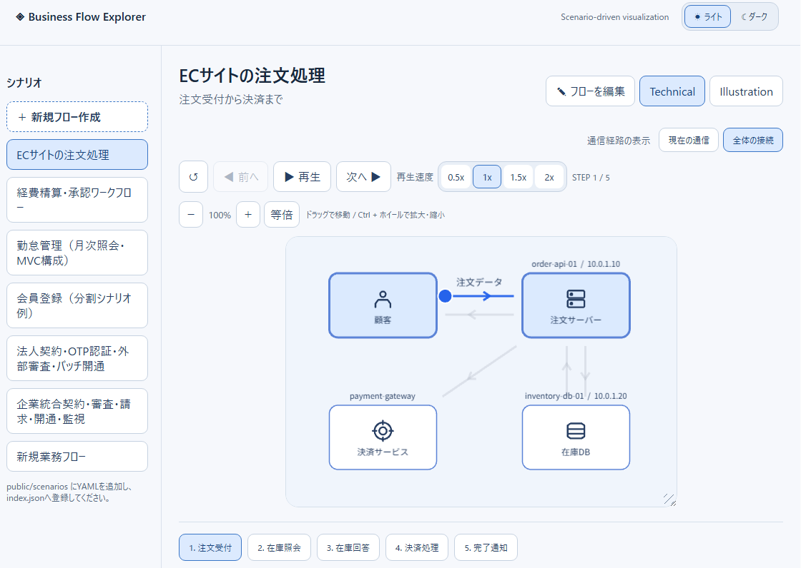
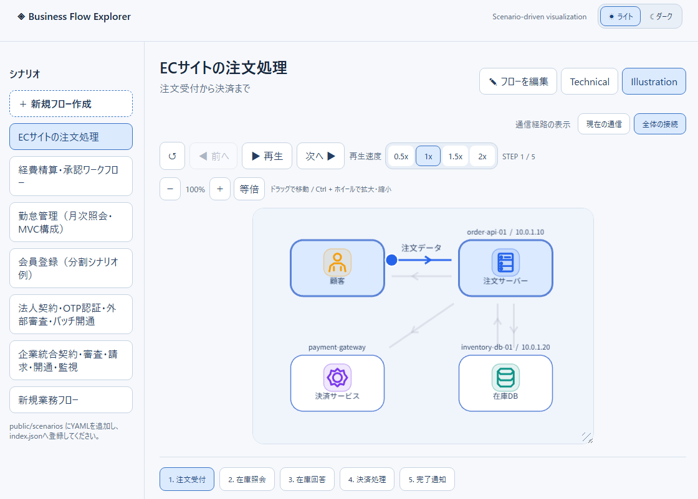
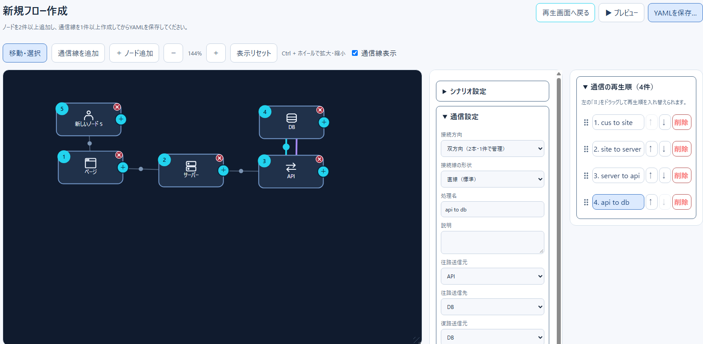
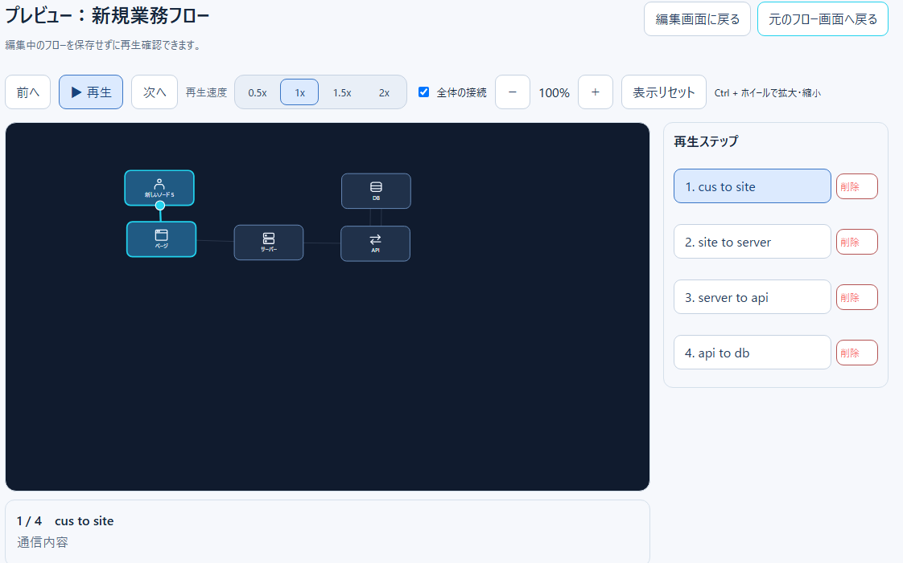

# Business Flow Explorer

業務フローやシステム間のデータのやり取りを、**YAMLで定義してアニメーション表示**するWebアプリケーションです。業務処理の説明やシステム構成の学習、処理順序の確認などに利用できます。

> **開発について**  
> 本プロジェクトは **ChatGPT（OpenAI）を使用して設計・コード作成・修正を行ったプロジェクト**です。生成された内容については、利用目的に応じて動作・品質・安全性を確認してください。

## 画面イメージ






## 主な機能

- シナリオを選択して、ノード間の通信をステップごとにアニメーション表示
- 再生・一時停止・前後のステップ移動・先頭へのリセット
- 再生速度の切り替え（0.5x / 1x / 1.5x / 2x）
- 最終ステップ終了時に自動停止し、再度再生すると最初から開始
- Technical / Illustration の表示スタイル切り替え（Illustrationは16種類の専用ピクトグラムとカテゴリ別アクセント色）
- ダーク / ライトテーマの切り替え（ブラウザに選択を保存）
- 通信関係を考慮したノードの自動配置（必要に応じて手動座標も指定可能）
- フローエディターでノード・通信設定・再生順を変更し、YAMLをローカル保存
- 編集中のプレビュー、未保存変更を検知した保存・破棄確認
- 双方向通信の往路・復路を1ステップで管理し、順番にアニメーション再生
- 接続線の直線／折れ線切り替え、条件分岐の再生先選択、ズーム・ドラッグ移動

## 起動方法

### 必要な環境

- Node.js と npm（使用するVite 7に対応するNode.jsバージョン）
- Webブラウザ

```bash
git clone https://github.com/Renasan-h/business-flow-explorer.git
cd business-flow-explorer
npm install
npm run dev
```

ターミナルに表示されたローカルURLをブラウザで開いてください。

| コマンド | 用途 |
| --- | --- |
| `npm run dev` | 開発サーバーの起動 |
| `npm run build` | TypeScriptの型チェックと本番ビルド |
| `npm run preview` | ビルド済みアプリのプレビュー |

## シナリオフォルダの設定（ローカルWeb版）

`npm run dev` の初回起動時、プロジェクト直下に `setting.config` がなければ自動生成します。個人設定のためGit管理対象外です。

```json
{
  "scenarioBaseDirectory": [
    "E:/tmp1",
    "E:/tmp2",
    "E:/tmp3"
  ]
}
```

- 複数のベースディレクトリを配列で指定します。従来の単一文字列形式も引き続き読み込めます。
- トップ画面のプルダウンで表示対象のベースディレクトリを切り替えます。シナリオ一覧は選択したルートの親YAMLだけを表示します。
- 各ベースディレクトリ直下に `template/` を用意してください。テンプレート読込では現在選択中のルートの `template/` 配下だけをファイルエクスプローラーで表示します。
- テンプレート読込画面の「直接読込」は内容を展開し、「サブシナリオ参照」は `file:` 参照として保持します。閉じるとファイル選択状態は初期化されます。
- 設定変更後はViteを再起動してください。ファイルの追加後はページを再読み込みしてください。
- ブラウザ単体で任意のローカルフォルダを読むことはできません。この機能は `npm run dev` または `npm run preview` のローカルサーバーで動作します。

## 使い方

1. 左側の「シナリオ」から表示したい業務フローを選びます。
2. 「▶ 再生」を押すと、ノード間の通信が順番にアニメーション表示されます。
3. 必要に応じて一時停止、前後移動、ステップ一覧からの直接選択、速度変更を行います。
4. 最終ステップの再生が終わると停止します。「最初から再生」を押すとSTEP 1から再開します。
5. 画面上部から表示スタイル（Technical / Illustration）とテーマ（ダーク / ライト）を変更できます。

### 同梱シナリオ

- **ECサイトの注文処理**：注文受付、在庫照会、決済など
- **経費精算・承認ワークフロー**：申請、承認、経理確認、振込依頼など
- **勤怠管理（月次照会・MVC構成）**：Controller / Service / Repository / DB / View の処理

## 独自シナリオの追加

シナリオは `setting.config` の `scenarioBaseDirectory` に指定したフォルダ内のYAMLファイルで管理します。初期値は `public/scenarios/` です。次の例を `public/scenarios/sample.yaml` として保存できます。

```yaml
schemaVersion: "1.0"
metadata:
  id: sample
  title: サンプル注文処理
  description: 顧客からサーバーへ注文を送信する例
  category: sales

actors:
  - id: customer
    name: 顧客
    type: person
  - id: server
    name: 注文サーバー
    type: server
    ip: 10.0.1.10
    instanceName: order-api-01

steps:
  - id: receive-order
    title: 注文受付
    description: 顧客が注文データを送信します。
    actions:
      - type: transfer
        from: customer
        to: server
        payload: 注文データ
        durationMs: 1500
```

開発サーバー起動中はシナリオ一覧の「↻ 更新」を押すと追加ファイルが反映されます。`index.json` の編集は不要です。

画面に表示するシナリオ名は **`metadata.title`** から取得します。ファイル名を日本語にする必要はありません。

### YAMLの主要項目

| 項目 | 内容 |
| --- | --- |
| `schemaVersion` | 現在は `"1.0"` |
| `metadata` | ID、表示名、説明、カテゴリ |
| `actors` | 登場するノードの定義（2件以上） |
| `actors[].id` | 通信元・通信先として参照する一意のID |
| `actors[].type` | `person` / `server` / `database` / `service` など全16種類 |
| `actors[].ip` / `instanceName` | 任意の補足情報 |
| `actors[].position` | 任意。省略すると自動配置。指定時は `{ x: 120, y: 190 }` の形式 |
| `steps` | 再生する処理の一覧（1件以上） |
| `steps[].actions` | 通信アクション。現状の描画・再生対象は各ステップの**最初のアクション** |
| `actions[].from` / `to` | `actors[].id` で定義した通信元・通信先 |
| `actions[].payload` | 通信時に表示する内容 |
| `actions[].durationMs` | 片道のアニメーション時間（ミリ秒、正の数） |
| `steps[].bidirectional` | `true` で往復通信を有効化。省略時は片方向 |
| `steps[].reverseFrom` / `reverseTo` | 双方向通信の復路送信元・送信先。双方向では再生時に必須 |
| `steps[].routing` | `straight`（直線）または `orthogonal`（折れ線） |
| `steps[].branchLabel` | 分岐先を識別する任意のラベル |

ノード配置は通信関係から自動計算しますが、すべての通信線の交差や重なりを解消することを保証するものではありません。複雑なシナリオでは `position` による調整も可能です。

### 双方向通信の記述例

双方向通信では、往路の `actions[0].from/to` と復路の `reverseFrom/reverseTo` をそれぞれ設定します。編集画面で双方向に変更した際は、復路に往路の逆方向が初期設定されます。

```yaml
steps:
  - id: request-response
    title: APIリクエストと応答
    description: クライアントから要求を送り、サーバーから応答を返します。
    bidirectional: true
    reverseFrom: server
    reverseTo: customer
    actions:
      - type: transfer
        from: customer
        to: server
        payload: GET /orders
        durationMs: 1200
```

片方向通信では `bidirectional`、`reverseFrom`、`reverseTo` を省略できます。双方向通信の復路が未設定、または存在しないActorを参照している場合、**読み込みと編集は可能**ですが、再生開始時にエラーを表示します。

## サブシナリオと共通Actorファイル

親シナリオの `steps` 配列内で、通常ステップとサブシナリオの参照を混在させられます。**再生順は `steps` の記述順そのもの**です。

```yaml
# public/scenarios/member-registration-modular.yaml
schemaVersion: "1.0"
metadata:
  id: member-registration-modular
  title: 会員登録（分割シナリオ例）
  description: 分割ファイルの読み込み例
  category: membership

actorFiles:
  - actors/member-actors.yaml

steps:
  - file: fragments/member-access.yaml
  - file: fragments/member-initial-data.yaml
  - file: fragments/member-confirm.yaml
```

### サブシナリオ間の通信

`steps[].file` に任意の `handoff` を指定すると、ファイル境界に通信ステップを挿入し、指定したActor間の通信線とアニメーションを表示します。

```yaml
steps:
  - file: fragments/member-access.yaml
  - file: fragments/member-initial-data.yaml
    handoff:
      from: web
      to: api
      payload: 初期表示データ取得要求
      durationMs: 1200
  - file: fragments/member-confirm.yaml
    handoff:
      from: db
      to: web
      payload: 初期表示データ取得結果
      durationMs: 1200
```

- `handoff.from` と `handoff.to` は通信するActorのIDです。通信元と通信先は明示的に指定します。
- `payload` は通信線のアニメーションで表示する固定文字列です。
- `handoff` を省略した場合は追加通信なしで、`steps` の記述順に連続再生します。
- `outputs` や `{{変数名}}` によるデータ引き継ぎ・変数展開はサポートしません。

サブシナリオの内容は通常の `steps` と同じ形式です。1ファイルに複数ステップを定義した場合も、そのファイル内の記述順に展開します。

```yaml
# public/scenarios/fragments/member-access.yaml
steps:
  - id: member-access
    title: 会員登録ページへアクセス
    description: 顧客が登録画面を開きます。
    actions:
      - type: transfer
        from: customer
        to: web
        payload: GET /member/register
        durationMs: 1500
```

共通Actor構成ファイルは `actorFiles` に指定できます。さらに、そのファイルの `actors` 配列から個別のActor定義ファイルを参照できます。

```yaml
# public/scenarios/actors/member-actors.yaml
actors:
  - file: customer.yaml
  - file: web.yaml
  - file: api.yaml
  - file: db.yaml
```

```yaml
# public/scenarios/actors/customer.yaml
actors:
  - id: customer
    name: 顧客
    type: person
```

- `actors` には直接定義と `- file: ...` を混在させられます。参照先からさらにActorファイルを参照することも可能です。
- Actor参照パスは記述元のファイルを基準に解決します。参照先はActor定義専用で、`steps` は含められません。
- シナリオごとに `actorFiles` で必要なActor構成を選べます。読み込んだActorはシナリオ全体で共有され、現時点ではステップごとのノード表示切り替えは行いません。

- `steps: - file: ...` の参照先は、指定元のYAMLファイルからの相対パスです。
- 通常のステップとサブシナリオを任意の順番で混在させられます。
- サブシナリオ内でも別のサブシナリオを参照できます。
- `order` を指定しても並び替えません。再生順は常に `steps` の記述順です。
- `actorFiles` はActor定義専用です。同じActor IDは統合し、矛盾する定義はエラーになります。
- 循環参照、重複したstep ID、未定義のActor参照はエラーになります。
- 親シナリオには `schemaVersion` と `metadata` が必要です。 `index.json` には親ファイルのみ登録します。
- 旧形式のファイル先頭に記述する `@ファイル名` はサポートしません。

## Technical と Illustration の違い

| 項目 | Technical | Illustration |
| --- | --- | --- |
| ノードアイコン | 共通のシンプルな線画 | ノード種類ごとに異なる専用ピクトグラム（16種類） |
| アイコン色 | テーマに合わせた単色 | ノード種別に応じたアクセント色 |
| アイコン背景 | なし | 角丸の背景付き |
| 主な用途 | システム構成・技術的な通信の確認 | 業務説明・視覚的なフローの把握 |

表示モードは通常再生画面の上部から切り替えます。エディターとSVGプレビューは現状共通の線画アイコンを使用します。

## 技術構成

- React 19 / TypeScript
- Vite 7
- PixiJS 8（描画・アニメーション）
- YAML（シナリオ記述）
- Zod（シナリオの形式と参照先の検証）

## 現時点の注意事項

- シナリオは静的なYAMLファイル（単一ファイルまたは分割参照）から読み込みます。画面からの**AI自動生成は未実装**です。エディターで編集したYAMLはブラウザの保存機能で出力しますが、配信元ファイルやGitHubは自動更新されません。
- 1ステップに複数のアクションを定義できますが、現在の描画・再生は先頭のアクションを対象とします。
- 開発中のプロジェクトです。環境やシナリオによって表示・動作の確認が必要です。

## ChatGPTの利用について

本プロジェクトは、要件整理、設計案の検討、実装コードの生成、既存コードの修正、ドキュメント作成に **OpenAIのChatGPTを利用**しています。ChatGPTが生成したコードを含むため、導入・改変・運用時には利用者自身による検証を推奨します。

## フローエディター

再生画面の「フローを編集」から、選択中のシナリオを編集できます。

- 「移動・選択」ではノードをドラッグして座標を変更し、背景をドラッグして表示範囲を移動します。
- 「通信線を追加」では送信元Actorと送信先Actorを順番に選択します。
- キャンバスは上段の全幅を使い、下段の設定パネルと再生順パネルでActor名・種類・座標、通信の往路送信元・往路送信先・復路送信元・復路送信先・内容・所要時間、ステップ順序を編集できます。
- 片方向の場合は復路設定を表示・保存しません。双方向に切り替えると復路設定が表示されます。
- 「再生画面へ戻る」で未保存変更がある場合は、保存するか破棄するかを確認します。
- 「YAMLを保存…」は対応ブラウザでは保存ダイアログを開き、任意のローカル保存先を指定できます。非対応ブラウザではダウンロードに切り替わります。
- 出力は単一のYAMLファイルです。読み込み時に展開したサブシナリオ・Actor参照は保存時にインライン化されます。元の分割ファイルやGitHubリポジトリは変更されません。
- 保存したYAMLをアプリのシナリオ一覧に追加する場合は、`public/scenarios/` への配置と `public/scenarios/index.json` の更新が必要です。


### 新規フロー作成

シナリオ一覧の「＋ 新規フロー作成」から、既存ファイルを使わずに空のフローを作成できます。ノードを2件以上追加し、通信線を1件以上作成してから「YAMLを保存…」を選択してください。保存先は対応ブラウザのファイル保存ダイアログで指定します。再生画面の通信経路表示は「全体の接続」が初期設定です。

### 編集中のプレビュー

フローエディターの「▶ プレビュー」から、保存前のActor配置と通信アニメーションを確認できます。再生・一時停止、前後ステップ、速度変更、全接続表示切替、拡大縮小とドラッグ移動に対応します。「編集画面に戻る」で編集状態を維持したまま戻ります。プレビューは編集内容を変更せず、YAMLファイルも保存しません。現状は各ステップの先頭の通信アクションをアニメーション表示します。双方向の場合は往路と復路を順番に再生します。

### 接続線の自動経路調整

フローエディターとプレビューでは、接続線をノード外枠から描画し、他のノードを避ける直交経路を探索します。ノード移動時には経路を再計算し、プレビューの通信パケットも同じ経路に沿って移動します。接続線同士の交差回避や経由点の手動編集は未対応です。

### 接続線の形状切替

接続線は初期状態ではノード外枠同士を結ぶ直線です。折れ線にしたい場合は編集画面で通信線を選択し、通信設定の「接続線の形状」を「折れ線（ノードを迂回）」に変更します。設定は通信ステップの `routing: orthogonal` としてYAMLに保存され、プレビューでも反映されます。未指定または `routing: straight` は直線です。直線は他のノードを自動迂回しません。

## 開発・保守担当者向け

初めてコードを読む場合は、[開発・保守ガイド](docs/maintenance-guide.md)を参照してください。ファイルの役割、シナリオのデータフロー、編集・プレビュー・再生の関係、変更時の確認項目を説明しています。
