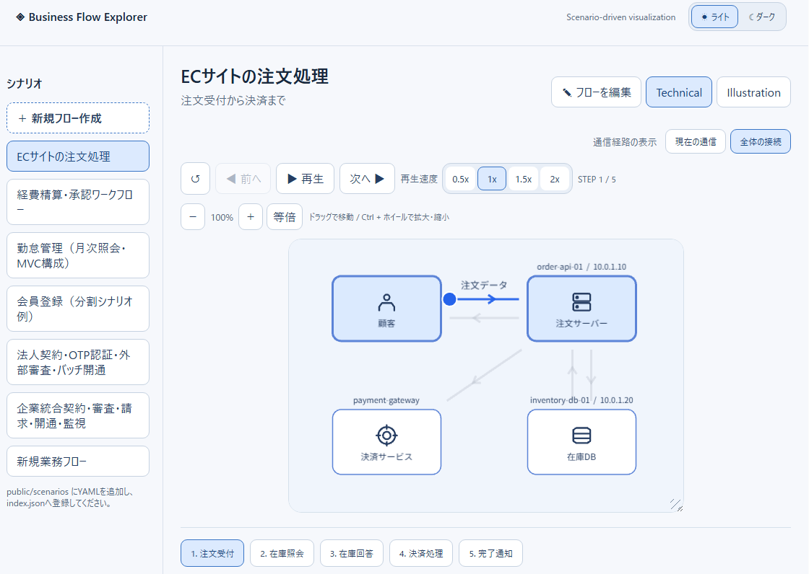
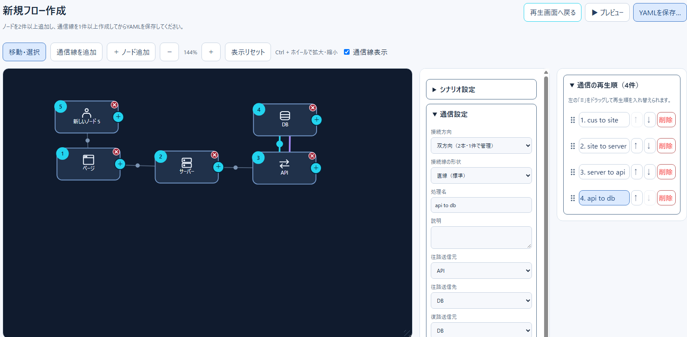
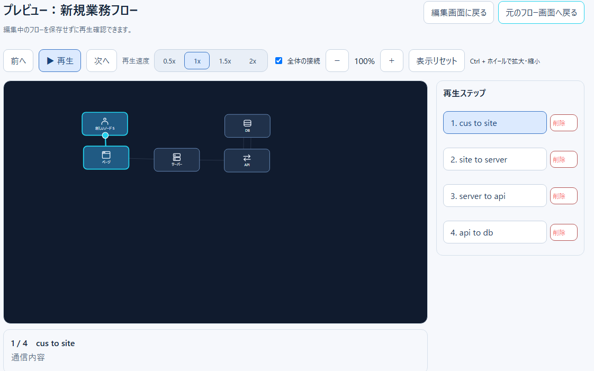

# 開発状況・ロードマップ

更新日：2026-11-13

## 1. 現在の構成

| 分野 | 実装 | 主なファイル |
| --- | --- | --- |
| 通常再生 | PixiJS、ステップ移動、速度変更、Technical/Illustration、分岐選択 | `src/App.tsx`, `src/playback/` |
| 編集 | SVGノード、通信線、双方向、領域、経由点、複数選択、再生順 | `src/FlowEditor.tsx`, `src/editor/` |
| プレビュー | 編集中データのSVG再生、編集画面への復帰 | `src/FlowPreview.tsx` |
| データ | YAML、Zod検証、分割シナリオ・Actor参照、テンプレート | `src/scenario.ts`, `src/editor/serializeEditorScenario.ts` |
| 自動テスト | Vitest、jsdom、Playwright Chromium | `src/__tests__/`, `e2e/` |
| CI | push/PRで型チェック、ビルド、単体/DOM、E2E | `.github/workflows/` |

## 2. 実装済み

- シナリオルート切替、カテゴリ別一覧、設定ファイルによるベースディレクトリ指定
- ノード追加・編集・複製・削除、接続線の作成・双方向切替、領域の追加・移動・サイズ変更
- 複数ノードの範囲選択・一括移動、通信の再生順変更、直線/折れ線と手動経由点
- IF定義と往路・復路参照、ノード詳細、編集状態のプレビュー、YAML保存
- サブシナリオ・共通Actorの参照、テンプレート直接展開・参照読込、ID衝突時の検証
- Vitest回帰テストとPlaywrightブラウザシナリオ、GitHub Actionsへの組み込み

「実装済み」はコード上の機能を意味し、全環境での実画面検証完了を意味しません。

## 3. 現時点の検証状況

| 項目 | 状況 |
| --- | --- |
| Vitest単体/DOMテスト | CI成功履歴あり |
| TypeScript型チェック・Viteビルド | CI成功履歴あり |
| Playwright通常再生・編集 | CI成功 |
| Playwright YAMLダウンロード | File System Access APIのテスト条件を修正後、CI成功 |
| 実ポインタードラッグ・リサイズ | 自動E2E未整備 |
| 実画面のぼやけ・拡大時表示 | 目視と画像比較の検証が必要 |
| 保存ファイルを再配置した完全E2E | 未整備 |

最新のCI結果は [GitHub Actions](https://github.com/Renasan-h/business-flow-explorer/actions) を参照してください。

## 4. 今後の計画

### 優先度A：テスト基盤の安定化
1. ~~PlaywrightのYAMLダウンロードテスト失敗を調査・修正し、全件成功を確認する。~~ 完了（[成功したCI](https://github.com/Renasan-h/business-flow-explorer/actions/runs/43279235957)）。
2. ロックファイルをリポジトリで管理し、CIの依存関係再現性を高める。
3. 単体・DOM・E2Eで共通のテスト用シナリオを整理する。

### 優先度B：実画面の操作テスト
1. ノードのドラッグ移動、複数選択、接続線追加・削除。
2. 往復通信、折れ線経由点、領域コンテナのリサイズ。
3. パネル最小化、画面幅変更、ズーム・パン、表示崩れ・ぼやけの回帰検証。
4. YAMLの保存→ファイル再配置→再読み込みまでのE2E。

### 優先度C：保守性と品質
1. `FlowEditor.tsx`に残る状態管理・イベント処理の責務を必要に応じて整理。
2. YAMLの形式変更時に読み込み・保存・参照解決・再生の整合性をテスト。
3. エラー時のUIフィードバックとアクセシビリティを改善。
4. 実画面スクリーンショットを最新UIに更新。

### 将来候補
- TauriによるWindowsデスクトップ版（別リポジトリを想定）
- 表示仕様の共通化、設計資料・IF仕様の参照機能強化

## 5. 画面イメージ

### 通常再生画面

> **最新画像への差し替え**：シナリオ一覧、カテゴリ、再生コントロール、右側ノード情報を含む画面。

### 編集画面

> **最新画像への差し替え**：複数選択モード、領域、往復通信、経由点、設定・再生順ペインを含む画面。

### プレビュー

> **最新画像への差し替え**：ステップ詳細、IFリンク、往復通信、速度変更を含む画面。

必要な撮影条件は [画面キャプチャ一覧](screenshot-checklist.md) に記載しています。
