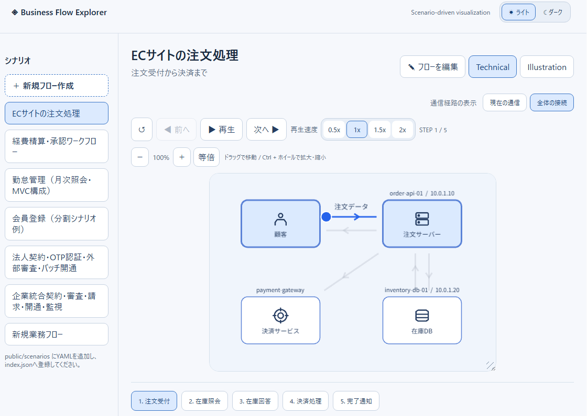
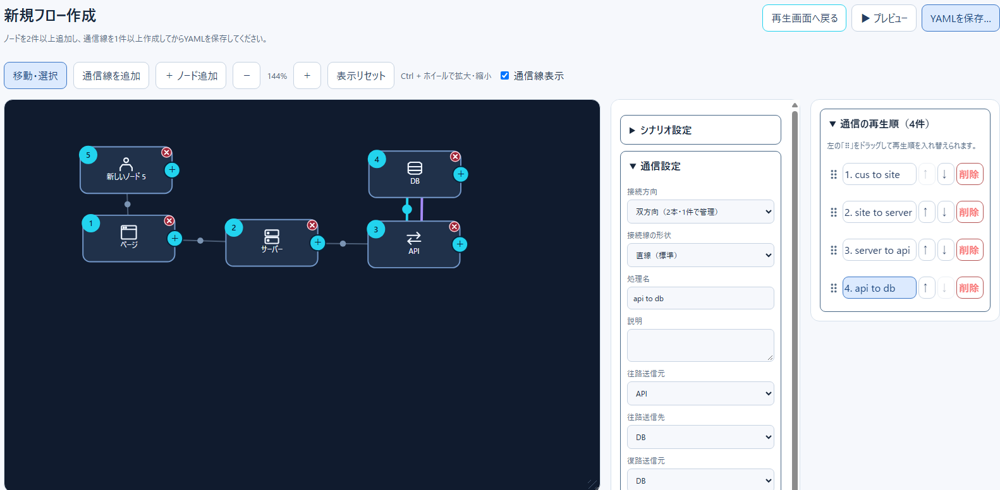
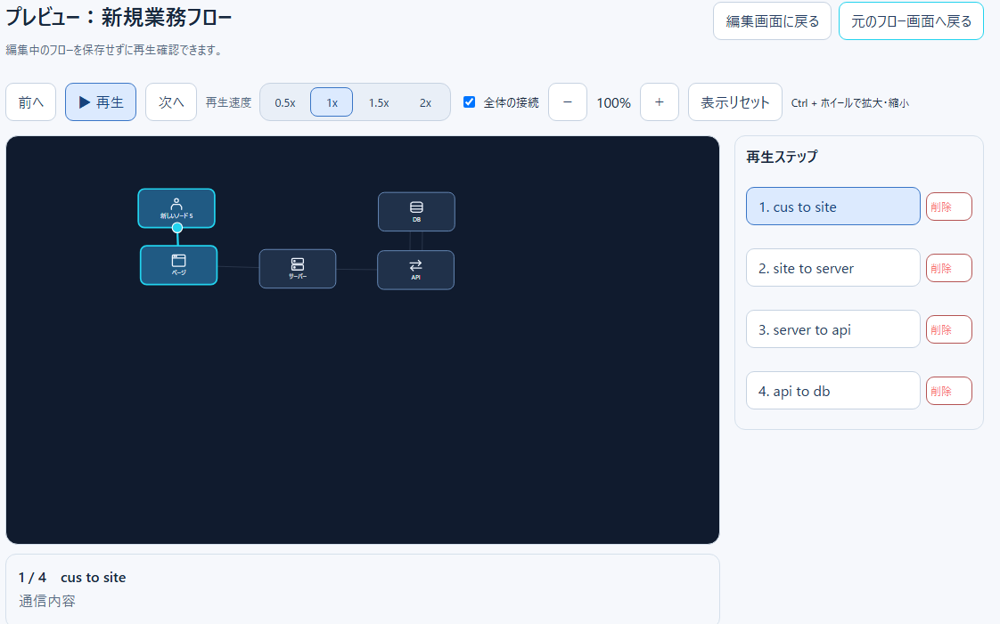

# 開発・保守ガイド（新人エンジニア向け）

更新日：2026-11-13

Business Flow Explorer の**現在のリファクタリング後の構成**を把握するためのガイドです。画面の大部分はReactコンポーネントへ分割され、編集ロジックも `src/editor/` の純粋関数・専用フックへ移動しています。

## 1. 全体像と読み進める順序

```text
設定されたシナリオルート（setting.config / デフォルト public/scenarios）
   ↓ Viteサーバー：scenario-roots.json / scenarios/<root>/manifest.json
src/scenario.ts：YAML読込 → Zod検証 → actorFiles / steps.file参照展開 → 自動配置
   ↓ Scenario { metadata, actors, steps, groups?, interfaces? }
src/App.tsx：ルート・シナリオ選択、分岐、再生状態、編集画面との切替
   ├─ src/playback/：通常再生（PixiJS）と詳細ドロワー・コントロール
   └─ src/FlowEditor.tsx：編集データのコピー・状態と操作の調停
        ├─ src/editor/：SVGエディターの表示と操作、保存・テンプレート処理
        ├─ src/FlowPreview.tsx：保存前データのSVGプレビュー
        └─ prepareEditorYamlSave → writeEditorYaml → ローカル保存／ダウンロード
```

推奨順序は `scenario.ts`（型・入力検証）→ `App.tsx` → `playback/` → `FlowEditor.tsx` → `editor/` です。最初から `FlowEditor.tsx` 全体を読むより、目的のヘルパーから辿る方が追いやすくなります。

## 2. 画面とコンポーネントの責務

| 対象 | 主な責務 | 変更の入口 |
| --- | --- | --- |
| `src/App.tsx` | 通常再生の状態、表示モード、分岐、編集への遷移 | 再生開始・停止、シナリオ切替 |
| `src/playback/PlaybackScene.tsx` | PixiJS描画・アニメーション、ノード選択、パン・ズーム、描画領域リサイズ | 通常再生の線・文字・描画サイズ |
| `src/playback/PlaybackControls.tsx` | 再生、前後ステップ、速度、ズーム操作 | 操作バー |
| `src/playback/ScenarioSidebar.tsx`・`CategoryTree.tsx` | カテゴリ階層とシナリオ一覧 | 一覧・モバイルドロワー |
| `src/playback/AppHeader.tsx` | シナリオルート切替、再読込、テーマ | ヘッダー |
| `src/playback/ActorDetailsDrawer.tsx`・`InterfaceDefinitionDrawer.tsx` | ノード情報・IF定義の参照 | 右側の詳細表示 |
| `src/FlowEditor.tsx` | 編集データの所有、各イベント・保存処理を呼び出す調整役 | 編集操作のつなぎ込み |
| `src/editor/EditorCanvas.tsx` | SVGをスクロール可能な描画領域に配置 | キャンバスの表示範囲 |
| `src/editor/EditorNodes.tsx`・`EditorEdges.tsx`・`EditorGroups.tsx` | ノード・通信線・領域のSVG描画 | 表示と操作ハンドル |
| `src/editor/EditorToolbar.tsx`・`EditorContextMenu.tsx` | 編集ツールバー・右クリック操作 | コマンドの表示 |
| `src/editor/EditorPanel.tsx`・`PlaybackOrderPanel.tsx` | 右側ペインと再生順一覧 | 最小化・順序変更 |
| `src/editor/ActorSettings.tsx`・`StepSettings.tsx`・`GroupSettings.tsx`・`ScenarioSettings.tsx` | データごとの設定フォーム | 入力項目 |
| `src/editor/InterfaceDefinitionDialog.tsx`・`TemplateImportDialog.tsx` | IF定義編集・テンプレートのファイル選択 | ダイアログ |
| `src/FlowPreview.tsx` | 編集中データのSVG再生、前後移動、速度・表示切替 | 保存前プレビュー |
| `src/style.css` | レイアウト・レスポンシブ・UI装飾 | 見た目や文字のぼやけ |

通常再生はPixiJS、エディターとプレビューはSVGです。**同じフローを別の描画実装で表示する**ため、ノードや配線の仕様変更時は両方を確認してください。

## 3. 編集処理の責務分離

`FlowEditor.tsx` は `actors`・`steps`・`metadata`・`groups`・`interfaces`・`templateReferences` を保持します。選択、ドラッグ、ズーム、モーダル、ペイン状態などは**保存対象ではないUI状態**です。

| 機能 | 主なファイル |
| --- | --- |
| SVG画面座標 → ワールド座標、ドラッグ差分 | `editor/coordinates.ts` |
| 開始操作の判定、ドロップ先判定 | `editor/pointerStartTargets.ts`、`pointerDropTargets.ts`、`pointerDropActions.ts` |
| 単一ノード・領域の移動とサイズ変更 | `editor/dragGeometry.ts`、`dragStartState.ts`、`useEditorDragPointerState.ts` |
| 複数選択・範囲選択・一括移動 | `editor/multiSelection.ts`、`multiSelectionPointerStart.ts`、`useMultiSelectionPointerState.ts` |
| 接続開始・双方向切替 | `editor/decideConnection.ts`、`connectionDirection.ts`、`useConnectionWirePreview.ts` |
| 折れ線の経由点追加・移動 | `editor/waypointInsertion.ts`、`waypointEditing.ts` |
| 再生順マーカー・順序更新 | `editor/playbackOrderGeometry.ts`、`PlaybackOrderMarkers.tsx`、`reorderSteps.ts` |
| ノード複製・削除時の参照整理 | `editor/duplicateEditorActor.ts`、`removeActorReferences.ts` |
| テンプレートの取得・直接展開・参照読込 | `editor/loadTemplateCatalog.ts`、`loadEditorTemplate.ts`、`prepareTemplateImport.ts`、`prepareEditorTemplateImport.ts`、`templateReferenceRegistration.ts` |
| IF定義ファイルの読み込み | `editor/readInterfaceFields.ts` |
| 保存前検証・YAML変換・ファイル出力 | `editor/validateEditorScenario.ts`、`serializeEditorScenario.ts`、`prepareEditorYamlSave.ts`、`writeEditorYaml.ts` |

### ポインターイベントを調べるとき

1. `FlowEditor.tsx` の `handleCanvasPointerDown` から開始対象を確認し、`resolvePointerStartTarget` の判定を見る。
2. `handleCanvasPointerMove` ではマルチ選択、経由点、再生順、通信線、ノード・領域移動を優先順位で分ける。
3. `handleCanvasPointerUp` でドラッグや接続の結果を確定し、関連する一時状態を終了する。
4. キャンセル時は `handleCanvasPointerCancel` で一時状態を破棄する。

SVGの `setPointerCapture` により、ドラッグ中のイベントターゲットがSVGへ変わることがあります。接続先はイベントターゲットだけでなく、**終了位置をワールド座標へ変換して判定**します。画面の拡大率・スクロール・CSSサイズを含む操作はPlaywrightで検証してください。

## 4. シナリオとYAMLの流れ

`src/scenario.ts` がZodでYAMLを検証します。スキーマには `metadata`、`actors`、`steps` のほか、`groups`、`interfaces`、双方向通信、分岐、IF参照、経由点などが含まれます。

シナリオ参照は `steps: - file: ...`、共通ノード参照は `actorFiles` で定義します。参照解決ではファイルパスの越境・循環参照・重複IDなどに注意します。再生順は **steps配列の順序** で決まり、分岐先は `src/branchPlayback.ts` で絞り込みます。

編集内容の保存経路は次の順番です。

```text
FlowEditor.save()
  → prepareEditorYamlSave（データ整合性と参照テンプレート検証）
  → serializeEditorScenario（YAML生成。片方向通信の不要な復路項目を除去）
  → writeEditorYaml（File System Access APIまたはダウンロード）
```

- ブラウザから保存しても元のシナリオファイルやGitHubは自動更新されません。
- `setting.config` のベースディレクトリ内に保存したYAMLを配置し、画面の「再読み込み」を押して反映します。フォルダ設定を変えた場合はサーバー再起動が必要です。
- テンプレートの「直接読込」は衝突したIDを採番し参照を付け替えます。「サブシナリオ参照」は元のIDを維持するため衝突を拒否し、参照部分を変更したまま保存する操作を禁止します。
- エディターは保存前に検証を実施し、エラー時はメッセージを表示して保存を中止します。

## 5. よくある変更の進め方

**新しいActor/Step項目を追加するとき：** `scenario.ts` のZodスキーマと型→ `ActorSettings.tsx`／`StepSettings.tsx` → シリアライズ → 通常再生・プレビュー → テストの順に整合性を確認します。既存YAMLと互換性が必要な任意項目は原則optionalにしてください。

**接続線・経由点を変更するとき：** `EditorEdges.tsx`、`connectionRouting.ts`、`FlowPreview.tsx`、`PlaybackScene.tsx` の違いを意識し、往路・復路の表示と保存形式を確認します。

**ノードや領域のドラッグを変更するとき：** `pointerStartTargets.ts`、`coordinates.ts`、`dragGeometry.ts`、`FlowEditor.tsx` を確認します。多重選択・接続ハンドル・リサイズハンドルの当たり判定を含めて検証します。

**シナリオ一覧を変更するとき：** `App.tsx`、`ScenarioSidebar.tsx`、`CategoryTree.tsx`、ローカルサーバーのシナリオ一覧生成を確認します。古い `index.json` 前提で実装を戻さないでください。

## 6. 自動テストとCI

```bash
npm install
npm test                     # Vitest + jsdom
npm run build                # tsc --noEmit + Vite
npx playwright install chromium
npm run test:e2e             # Playwright Chromium
```

- `src/__tests__/`：編集・再生ロジック、YAML往復、IF定義、描画補助、DOMをテスト。
- `e2e/businessFlow.spec.ts`：通常再生、編集画面遷移、プレビュー、保存、ポインター操作をChromiumで確認。
- `.github/workflows/ci.yml`：push・Pull Request時にVitest/ビルドとPlaywrightを別ジョブで実行。
- `.github/workflows/validate.yml`：Vitestとビルドの追加検証。
- Playwright失敗時は `playwright-results` の証跡（スクリーンショット・トレース）を参照。

2026-11-13時点、[CI実行 43284008816](https://github.com/Renasan-h/business-flow-explorer/actions/runs/43284008816) では **型チェック・Vitest・Viteビルド成功、Playwrightのノードドラッグ検証1件が失敗（5件成功）**。原因はスクロール型SVGキャンバスで操作対象が表示領域外だったことです。テストで対象を表示領域へスクロールしてからドラッグするよう修正し、[CI実行 43289270584](https://github.com/Renasan-h/business-flow-explorer/actions/runs/43289270584) で **Vitest・TypeScript・Vite・Playwright全ジョブの成功を確認**しました。

詳細は [テスト・CIガイド](testing-guide.md) を参照してください。

## 7. 既知の制約・残課題

- 通常再生のPixiJSと編集／プレビューのSVGは描画方式が異なり、線形状や表示の完全一致を保証しません。
- 1ステップ複数アクションのうち、主に先頭アクションが描画・再生対象です。
- 通常再生画面の文字の鮮明さ、リサイズ時の描画領域、複数ノードの実ドラッグなどは継続検証が必要です。
- YAML保存はファイル出力であり、配信元の自動更新・GitHubへの反映は行いません。
- パス制約、参照テンプレートの整合性、CIの安定性を継続して検証します。

## 8. 画面資料







> これらは現行UIへの一致を再確認していない既存画像です。新しい画像の撮影対象と差し替え位置は [画面キャプチャ一覧](screenshot-checklist.md) を参照してください。

最新の実装・残作業は [開発状況・ロードマップ](development-status.md) にまとめています。
