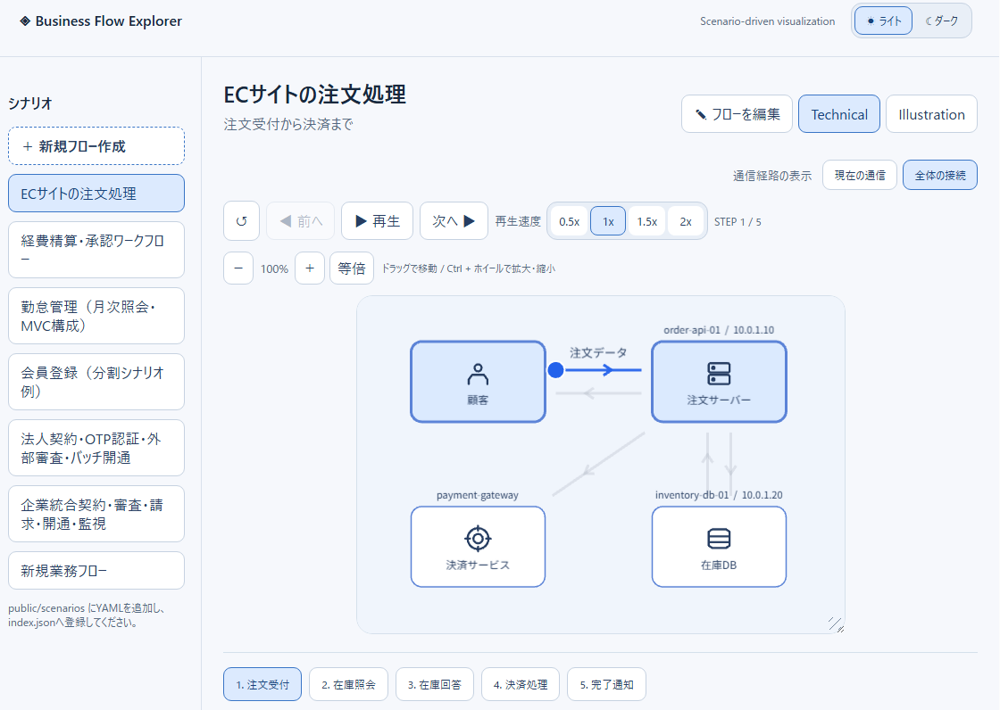
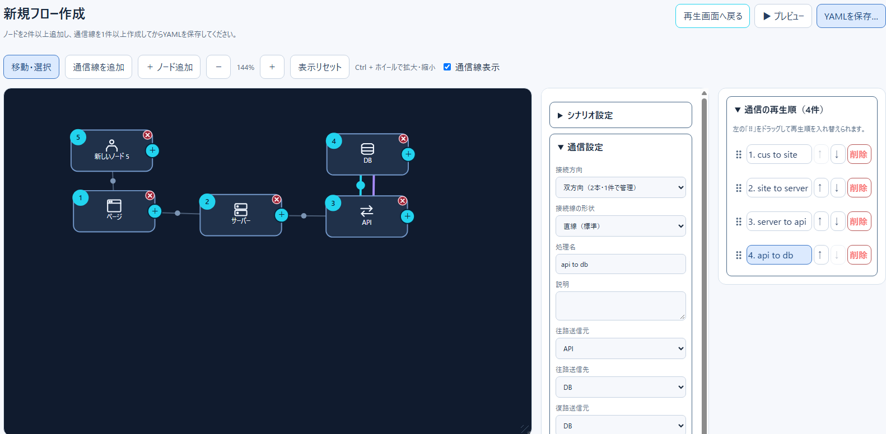
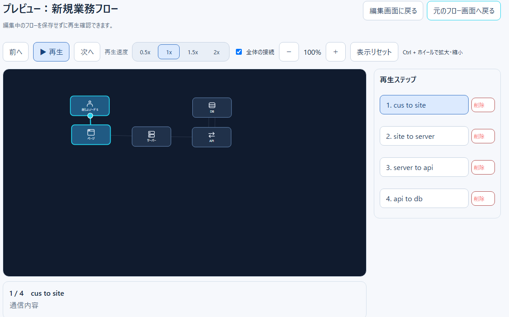

# 画面キャプチャ一覧・差し替えチェックリスト

更新日：2026-11-13

この文書ではREADME・docsに掲載する画像の**撮影対象・配置場所・差し替え条件**を管理します。現在の `docs/images/*.png` は既存画像です。現行UIとの一致を確認していないため、最新の実画面キャプチャとは断定しません。

## 画像差し替え対象

| 画像パス | 撮影対象 | 撮影時の条件 |
| --- | --- | --- |
| `docs/images/technical.png` | 通常再生：Technical | ノードと通信線、左側シナリオ一覧、再生操作が見える |
| `docs/images/illustration.png` | 通常再生：Illustration | Technicalと同じシナリオ・ステップで撮影 |
| `docs/images/editor.png` | フローエディター | ノード、双方向通信、領域、設定ペイン、再生順ペインが見える |
| `docs/images/preview.png` | 編集中プレビュー | 往路・復路、ステップ詳細、速度ボタンが見える |

## 追加画像の候補

以下は**画像ファイル未作成**です。実画面撮影後に配置し、文書から参照してください。

- `docs/images/editor-multi-selection.png`：複数ノード選択・移動モードで選択数が表示された状態
- `docs/images/editor-waypoints.png`：折れ線通信と経由点のハンドル
- `docs/images/editor-interface.png`：IF定義ダイアログ、名称・型・説明・必須の各列
- `docs/images/editor-template-explorer.png`：テンプレートエクスプローラーのフォルダ選択
- `docs/images/playback-details.png`：通常再生中のノード詳細ドロワー
- `docs/images/ci-playwright.png`：GitHub ActionsのChromium E2E成功結果（成功後に撮影）

## 現在の画像の位置

### 再生画面（Technical）

### 編集画面

### プレビュー

## 撮影時の注意

1. 開発用サンプルシナリオを使い、個人情報・社内の機密情報・実IPアドレス・アクセストークンを表示しない。
2. 通常再生とIllustrationは同じシナリオ・ステップを使用する。
3. 可能ならデスクトップ幅1440px程度で撮影し、別途モバイル幅での崩れも検証する。
4. 画像を差し替えた際はREADMEと各ガイドの説明が現行UIと一致するか確認する。
5. CIの失敗スクリーンショットは不具合調査用であり、成功画面の製品紹介画像として流用しない。
