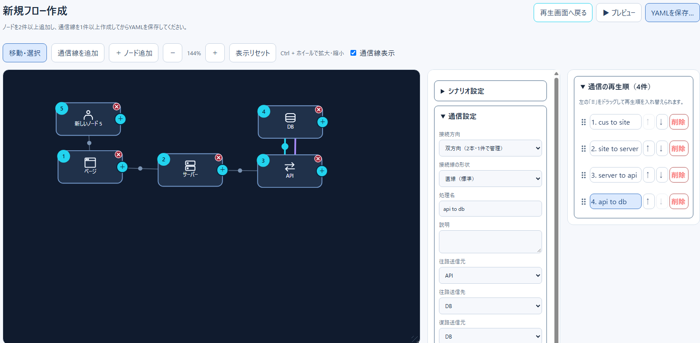

# テスト・CIガイド

更新日：2026-11-13

## 1. 目的と検証範囲

本プロジェクトはReact/Vite/TypeScriptの編集画面、PixiJSの通常再生画面、SVGのプレビュー画面、YAMLシナリオの入出力から構成されます。変更による退行を検知するため、純粋関数・DOM・実ブラウザの3段階でテストします。

| レイヤー | 使用技術 | 対象 |
| --- | --- | --- |
| ロジック | Vitest | ノード、通信、分岐、再生順、経由点、テンプレート、入力検証 |
| DOM | Vitest + jsdom | 編集・プレビュー画面の表示とボタン操作 |
| E2E | Playwright + Chromium | 通常再生、編集画面遷移、プレビュー、YAMLダウンロード |
| 静的検証 | TypeScript / Vite | 型チェックと本番ビルド |

## 2. テストコードの配置

| ファイル | 主要な確認事項 |
| --- | --- |
| `src/__tests__/editorPlayback.test.ts` | 編集・再生ロジック、通信、再生順、分岐 |
| `src/__tests__/editorFeatures.test.ts` | 経由点挿入・移動、ノード複製、テンプレートID衝突、領域 |
| `src/__tests__/fileAndSelection.test.ts` | SVG選択対象、IF定義インポート、テンプレート一覧、保存API |
| `src/__tests__/yamlRoundtrip.test.ts` | YAMLの保存・再読込、双方向通信、領域、不正参照拒否 |
| `src/__tests__/screens.test.tsx` | 編集画面とSVGプレビューのDOM操作 |
| `e2e/businessFlow.spec.ts` | 通常再生のステップ選択、表示切替、編集、プレビュー、保存 |

## 3. ローカル実行

```bash
npm install
npm test
npm run build

# 初回のみブラウザを取得
npx playwright install chromium
npm run test:e2e

# 失敗原因を画面上で調査
npx playwright test --headed
npx playwright show-report
```

Playwrightは `playwright.config.ts` でローカルViteサーバーを起動します。ブラウザテストはテスト用のシナリオJSON/YAMLレスポンスを差し替え、実運用のシナリオを変更しません。失敗時は `test-results/` に証跡を残します。

## 4. CI

- `.github/workflows/ci.yml`：push、Pull Request、手動実行。Vitest＋型チェック＋ビルドと、Chromium E2Eを別ジョブで実行します。
- `.github/workflows/validate.yml`：push等の追加検証。Vitest＋ビルドを実行します。
- Node.js 22を使用。lockfileがあれば `npm ci`、なければ `npm install` を使用します。再現性を高めるには `package-lock.json` の管理が推奨されます。
- E2Eが失敗するとGitHub Actionsに `playwright-results` アーティファクトを保存します。

## 5. 検証済み／未検証

- **確認済み**：CIでVitest、TypeScript型チェック、Viteビルドが成功した履歴があります。
- **要対応**：2026-11-13時点でPlaywright初回実行は3件中2件成功、1件（YAMLダウンロード検証）失敗。E2E全件成功とは扱いません。
- **追加予定**：実ポインター操作でのノード移動、通信線作成、範囲選択、領域リサイズ、折れ線ハンドル、ブラウザ幅変更、テーマ、表示ぼやけ。
- **追加予定**：保存したYAMLを実際の配信ディレクトリに置いて再読み込みし、編集値が再現されることを検証する完全な往復E2E。

## 6. テスト追加ルール

1. 変更したロジックには正常系・境界値・不正系のテストを追加します。
2. 編集値を保存する機能ではYAMLへのシリアライズと再読込の両方を確認します。
3. 画面のクリック操作はアクセシブルなロール・名称を優先して要素を特定します。
4. ドラッグやPixiJS描画などjsdomで再現できない操作はPlaywrightで検証します。
5. テストの期待値を実装に合わせて無条件に変更せず、仕様との差異を先に確認します。

## 7. 画面資料

最新の画面キャプチャが必要な箇所は [画面キャプチャ一覧](screenshot-checklist.md) を参照してください。



> **画像更新対象**：ノード複数選択、通信線の往復設定、経由点ドラッグ、右側設定パネルを含む最新エディター画面。
